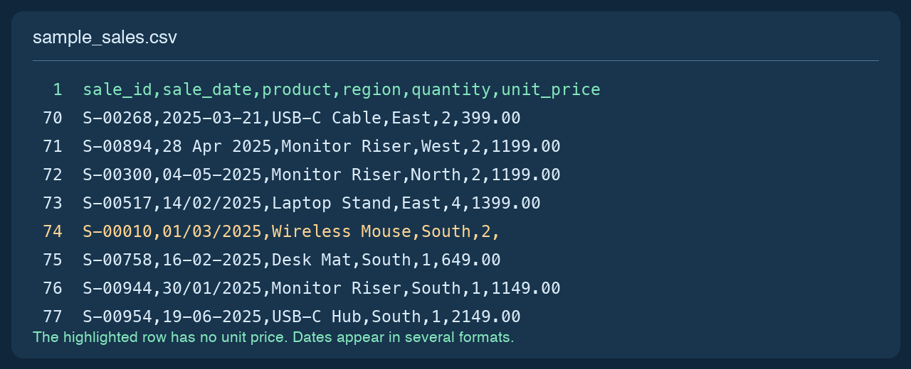
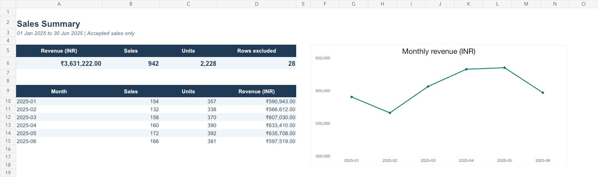
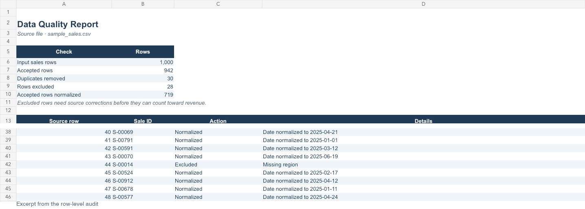

# AutoReport — Excel & CSV Reporting Automation

AutoReport turns recurring sales exports into a consistent Excel report your team can review and share. It replaces manual sorting, duplicate checks and report assembly with one repeatable run. Managers see sales by month, product and region. The person responsible for the source file gets a row-level list of issues to correct.

Client projects start at **₹5,000**. Each engagement defines the source format, reporting rules, acceptance checks and handover before work starts. See [packages and outreach messages](CLIENT_OFFER.md).

## Watch the 45-second demo

[**Watch the AutoReport walkthrough (MP4)**](https://raw.githubusercontent.com/Rakshita-0023/AutoReport-Python-Automation/main/docs/media/autoreport-demo.mp4) · [Download the sample Excel report](output/sample_report.xlsx)

The walkthrough shows the source export, the command and its output, and the finished workbook. All figures come from the included synthetic sample.

### Source export

The CSV contains mixed date formats, duplicate rows and missing values. This excerpt shows a blank unit price.



### Sales summary

The report opens with accepted revenue, sales volume and the monthly trend. Separate tabs break down performance by product and region.



### Data quality report

The workbook reconciles the input row count and lists the source row and reason for each exclusion.



## Run the portfolio demo

Use Python 3.11 or later. Open a terminal in the project folder and run:

```bash
python3 -m venv .venv
source .venv/bin/activate
python -m pip install -r requirements.txt
python main.py --input data/sample_sales.csv --output output/sample_report.xlsx
python -m pytest -q
```

On Windows PowerShell, use `py -3 -m venv .venv` and `.\.venv\Scripts\Activate.ps1` for the first two commands. Open [the example workbook](output/sample_report.xlsx) in Excel. Close the workbook before regenerating it if Excel locks the file.

The included sample is entirely synthetic. Regenerate the same 1,000 records with `python generate_sample.py`. The sample run retains **942 sales**, removes **30 repeated rows**, and excludes **28 rows** for missing or invalid values. The accepted sales total **₹3,631,222.00**.

| Workbook tab | What to review |
| --- | --- |
| Sales Summary | Accepted revenue, sale and unit counts, exclusions and monthly trend |
| Product Performance | Ranked revenue, sales and units by product |
| Region Performance | Ranked revenue, sales and units by region |
| Cleaned Sales Data | Filterable accepted rows with original record numbers, dates and INR amounts |
| Data Quality Report | Reconciled row counts and filterable reasons for exclusions, duplicate removal and normalization |

The workbook is a snapshot of one run. Rerun the command to refresh it from a corrected or newer export.

## Source contract and review rules

- Supply a comma-delimited UTF-8 CSV or the first worksheet of an XLSX. Row one must contain `sale_id, sale_date, product, region, quantity, unit_price`. Header case and surrounding spaces are ignored. Other columns are ignored. Export required XLSX fields as values before running the report.
- Use one unique sale ID per record. Store IDs with leading zeroes as text. Product and region names are grouped as written after trimming surrounding spaces.
- Use Excel date cells or text in `YYYY-MM-DD`, `DD/MM/YYYY`, `DD-MM-YYYY`, or `DD Mon YYYY` format. Slash dates use day-first order, so `04/05/2025` means 4 May.
- Quantity is a positive whole number. Unit price is a nonnegative INR value with up to two decimal places. Use plain numbers without separators or currency symbols. Revenue is quantity multiplied by unit price, with no separate tax or discount adjustment.
- Identical sales fields after trimming count once. If the same nonblank ID remains on different rows, AutoReport excludes all competing records for review.
- AutoReport excludes incomplete or invalid records and explains the reason in the workbook when there are accepted rows. Missing prices and quantities stay unknown. A supplied price of zero is valid. Review exclusions before using totals for decisions.
- Missing headers, malformed files and runs with no valid sales exit with a readable error. A failed run preserves an existing report.

## Record and sell the demo

Follow the [45-second recording script](DEMO_SCRIPT.md). Show the raw export, run the command, then show the summary and the row-level audit. Share the recording and synthetic workbook with a business that already assembles reports from recurring exports. Ask for a redacted sample and the report they prepare today, then quote a fixed scope from the [client offer](CLIENT_OFFER.md).
